```
██████╗      ██╗██╗██████╗ ██╗   ██╗    ███████╗ ██████╗ ██╗    ██╗
██╔══██╗     ██║██║██╔══██╗╚██╗ ██╔╝    ██╔════╝██╔═══██╗██║    ██║
██║  ██║     ██║██║██████╔╝ ╚████╔╝     ███████╗██║   ██║██║ █╗ ██║
██║  ██║██   ██║██║██╔══██╗  ╚██╔╝      ╚════██║██║   ██║██║███╗██║
██████╔╝╚█████╔╝██║██████╔╝   ██║       ███████║╚██████╔╝╚███╔███╔╝
╚═════╝  ╚════╝ ╚═╝╚═════╝    ╚═╝       ╚══════╝ ╚═════╝  ╚══╝╚══╝
```

<div align="center">

[](https://www.linkedin.com/in/djiby-sow-rebollo/)
[](https://github.com/Lancelcode)


</div>

---

## `$ whoami`

```json
{
  "name"       : "Djiby Sow Rebollo",
  "role"       : "MEng Software Engineering student, systems and performance",
  "university" : "Edinburgh Napier University (MEng Software Engineering)",
  "location"   : "Edinburgh, Scotland",
  "focus"      : ["Systems programming in C", "Backend engineering", "Performance and HPC"],
  "building"   : ["PulseDB, a Redis-compatible server in C99", "A POSIX shell in C"],
  "learning"   : ["Mojo, SIMD and parallel kernels", "Linux internals", "Applied security"],
  "looking_for": "Placement year or developer role from January 2027",
  "principle"  : "Understand the machine. Don't just use the tools, build them."
}
```

---

## `$ ls -la projects/flagship/`

### 🧠 [PulseDB](https://github.com/Lancelcode/PulseDB) · Redis-compatible database server in C99
> *How does a command travel from a socket to a data structure and back?*

An in-memory database server written from scratch in C99 with no third-party libraries. It speaks the Redis wire protocol (RESP), so `redis-cli` talks to it directly, and replies were checked against Redis 7 for the supported commands.

- Single-threaded event loop on `poll()` with non-blocking sockets, serving many clients at once
- Strings, lists, hashes, sorted sets, streams and geo commands, plus `MULTI`/`EXEC` transactions
- Key expiry without a background thread, pipelining, and loading string keys from a Redis RDB file
- CI on every push, Dockerfile, benchmarks and tests in the repo

`C99` `Networking` `Event Loops` `Data Structures` `Docker` `GitHub Actions`

---

### 🔧 [project-manager-api](https://github.com/Lancelcode/project-manager-api) · REST API in Java 21 and Spring Boot
> *Every layer written by hand, to learn how a production Spring app fits together.*

Projects and tasks API with JWT authentication, PostgreSQL persistence, Jakarta Bean Validation, structured JSON errors and Swagger docs. One `docker compose up` starts the full stack, and GitHub Actions runs the tests on every push.

`Java 21` `Spring Boot` `PostgreSQL` `Docker` `JWT` `Maven` `GitHub Actions`

---

### 🌱 [GreenScore](https://github.com/Lancelcode/GreenScore) · Full-stack sustainability platform
> *42 PHPUnit tests. CSRF protection. Rate limiting. Certificate generation.*

Organisations complete a 10-category environmental assessment, earn one of 14 badge levels and receive a certificate. Built in PHP and MySQL with session-based roles, an admin dashboard and a security layer. The project that taught me what "production-ready" actually means.

`PHP 8.2` `MySQL` `Bootstrap` `PHPUnit` `Security`

---

### 🔍 [nvvri](https://github.com/Lancelcode/nvvri) · AI-assisted nursery finder
> *Natural language search. Deployed at [nvvri.co.uk](https://nvvri.co.uk).*

Search UK nurseries in plain English and filter by area, age range, Ofsted rating and price. Next.js 15, React 19 and strict TypeScript on PostgreSQL with Prisma, hand-written styles with no CSS framework, and Playwright end-to-end tests running in CI.

`TypeScript` `Next.js` `React` `PostgreSQL` `Prisma` `Playwright` `Vercel`

---

## `$ ls projects/in-progress/`

| Project | Status | What it is teaching me |
|---------|--------|------------------------|
| [mojo-bench](https://github.com/Lancelcode/mojo-bench) | 🔄 Exploring | Mojo against Python, NumPy and C on eight kernels: SIMD, cache blocking, parallelism |
| POSIX shell in C | 🔄 In progress | Process forking, pipes, signals, PATH resolution |
| [Group chat over sockets](https://github.com/Lancelcode/Group-Chat-Sockets) | ✅ Complete | TCP, multi-client handling, concurrency in Java |
| Git internals | 📋 Planned | Content-addressable storage, DAGs, hashing |
| Compiler (subset) | 📋 Planned | Lexing, parsing, AST, code generation |

---

## `$ cat current_learning.log`

```
[now]   Performance      Mojo, SIMD, cache behaviour, OpenMP-style parallelism
[now]   Systems          C, Linux internals, memory, concurrency, I/O
[side]  Security         TryHackMe and PortSwigger labs
```

The direction: strong systems foundations first, then high-performance computing and accelerated software.

---

## `$ cat stack.txt`

**Languages**


**Backend and Web**


**Databases**


**Testing**


**Infrastructure**


---

## `$ cat philosophy.txt`

I came into software engineering from an unusual direction: not from a computer science family or a bootcamp, but from figuring things out because I had to. Not knowing something has always just been the starting point.

I build things from scratch because you cannot truly understand a system until you have tried to build one.

> If not me, who? If not now, when?

---

<div align="center">



</div>

---

## `$ echo "Let's talk"`

Working on systems software, backend infrastructure or anything performance-critical? I'd like to hear about it.

[](https://www.linkedin.com/in/djiby-sow-rebollo/)

---

<div align="center">
<sub>⚡ Actively building · 📍 Edinburgh, Scotland · 🎯 Open to a placement year or developer role from January 2027</sub>
</div>
