```
██████╗      ██╗██╗██████╗ ██╗   ██╗    ███████╗ ██████╗ ██╗    ██╗
██╔══██╗     ██║██║██╔══██╗╚██╗ ██╔╝    ██╔════╝██╔═══██╗██║    ██║
██║  ██║     ██║██║██████╔╝ ╚████╔╝     ███████╗██║   ██║██║ █╗ ██║
██║  ██║██   ██║██║██╔══██╗  ╚██╔╝      ╚════██║██║   ██║██║███╗██║
██████╔╝╚█████╔╝██║██████╔╝   ██║       ███████║╚██████╔╝╚███╔███╔╝
╚═════╝  ╚════╝ ╚═╝╚═════╝    ╚═╝       ╚══════╝ ╚═════╝  ╚══╝╚══╝
```

<div align="center">

**Systems, backend and security engineering · Understand the machine, then build the tools**

[](https://www.linkedin.com/in/djiby-sow-rebollo/)
[](https://djibysow.com/)


</div>

---

## `$ whoami`

```json
{
  "name"       : "Djiby Sow Rebollo",
  "role"       : "Software Engineering student → Systems & Security Engineer",
  "university" : "Edinburgh Napier University",
  "location"   : "Edinburgh, Scotland",
  "focus"      : ["Systems", "Backend", "Security", "Performance / HPC", "AI/ML engineering"],
  "learning"   : ["Python at depth", "Mojo & SIMD", "Applied cryptography", "AI/ML engineering"],
  "available"  : "Junior engineering roles from late 2026",
  "principle"  : "Understand the machine. Don't just use the tools, build them."
}
```

---

## `$ ls projects/featured/`

### ⚡ mojo-bench &nbsp;·&nbsp; How fast is Mojo, really?
> *Same machine, same inputs, correctness checked before any timing is reported.*

Benchmarks **Mojo** against pure Python, NumPy, C and C with OpenMP across eight classic kernels (matrix multiply, n-body, Mandelbrot, reductions, hash tables, word counting). It also measures thread scaling and places the kernels on a roofline built from the machine's measured limits.

- Mandelbrot: Mojo's explicit SIMD is **4.3× faster than C** on one core, where idiomatic C does not vectorise
- Same algorithm, same code shape: Mojo and C run at the same speed, so the gap is about SIMD, not magic
- Every claim is reproducible with `make bench`, and the write-up says where Mojo does *not* win

`Mojo` `Python` `NumPy` `C` `OpenMP` `Benchmarking` `Roofline Analysis` `GitHub Actions`

[Repository](https://github.com/Lancelcode/mojo-bench) · [Results](https://github.com/Lancelcode/mojo-bench/tree/main/results) · [Write-up](https://github.com/Lancelcode/mojo-bench/blob/main/docs/writeup.md)

---

### 🗄️ PulseDB &nbsp;·&nbsp; Redis-compatible database server from scratch
> *Built to understand what happens between a socket and a data structure.*

An in-memory key-value server written in **C99** with **no third-party libraries**. It speaks the Redis wire protocol (RESP), so `redis-cli` works against it, and it supports strings, lists, hashes, sorted sets, streams, geo, and `MULTI`/`EXEC`. Replies for the supported commands were checked against Redis 7.

- Single-threaded event loop on non-blocking sockets, with lazy key expiry and no background thread
- Bounds-checked, restartable RESP parser; tests run under AddressSanitizer and UBSan on GCC and Clang
- Profiling-driven optimisation: a hash-indexed sorted set made `ZSCORE` **280× faster** in the store benchmark, and pipelined `GET` throughput rose about **5×**
- Honest limits are documented: no persistence on write, no auth or replication yet

`C` `Systems Design` `Networking` `RESP` `Data Structures` `Docker` `CI`

[Repository](https://github.com/Lancelcode/PulseDB) · [Architecture and design decisions](https://github.com/Lancelcode/PulseDB#key-design-decisions)

---

### 🌱 GreenScore &nbsp;·&nbsp; Full-stack sustainability platform
> *Security was a design requirement from the first commit, not a later patch.*

A PHP and MySQL web application where organisations score their environmental impact across 10 categories, earn badge levels, and receive downloadable certificates. It has a role-based admin dashboard, a community board, and a feedback system.

- **42 PHPUnit tests** covering authentication, scoring thresholds, input validation and ownership checks
- Prepared statements, CSRF tokens, `password_hash()`, session regeneration, login rate limiting and hardened cookies
- Built as a Graded Unit 2 assessment at Edinburgh College, then taken further for security and testing

`PHP 8.2` `MySQL` `Bootstrap 5` `PHPUnit` `Security` `Session Management`

[Repository](https://github.com/Lancelcode/GreenScore)

---

## `$ ls projects/other/`

| Project | What it is | Stack |
|---|---|---|
| 🔍 [nvvri](https://nvvri.vercel.app) | AI-assisted nursery finder with natural-language search across area, age range, Ofsted rating and price | TypeScript, Next.js 15, React 19 |
| 🔧 project-manager-api | REST API with JWT authentication, role-based access control, PostgreSQL, Docker and a GitHub Actions pipeline | Java 21, Spring Boot, PostgreSQL |
| 🎓 [Revision kit](https://github.com/Lancelcode/adb-revision-lab) | Docker-based labs, question bank and quiz for advanced database systems | PostgreSQL, MongoDB, Python |

---

## `$ cat rebuilding-the-stack.md`

Systems I am rebuilding from protocol level, because *if you can build it, you understand it*:

| Tool | Status | What it taught me |
|------|--------|-------------------|
| PulseDB (Redis-compatible server) | ✅ Complete | Event loops, RESP parsing, data structures, sanitizers |
| Group chat (sockets) | ✅ Complete | TCP, multi-client handling, concurrency |
| Own shell | 🔄 In progress | Process forking, pipes, signals, PATH resolution |
| AI coding agent | 🔄 In progress | LLM APIs, tool calling, agent loops |
| Git internals | 📋 Planned | Content-addressable storage, DAGs, hashing |
| Compiler (subset) | 📋 Planned | Lexing, parsing, AST, code generation |

---

## `$ ls security/`

Hands-on security learning: penetration testing, log analysis, CVE research and hardening, through TryHackMe and Hack The Box tracks. *Offensive skills make better defensive engineers.*

`Parrot OS` `Linux` `Pen Testing` `CVE Analysis` `Hardening`

---

## `$ cat stack.txt`

**Languages**


**Frameworks & frontend**


**Data & testing**


**Infrastructure & tools**


**Security**


---

## `$ cat current_learning.log`

```
[2026] █████████░░░░░░░░░░░  Python at depth          — OOP, testing, packaging
[2026] ██████░░░░░░░░░░░░░░  Mojo & SIMD              — vectorisation, parallel kernels
[2026] ██████░░░░░░░░░░░░░░  AI/ML foundations        — numpy, pandas, scikit-learn
[2026] ████████░░░░░░░░░░░░  Applied security         — TryHackMe, PortSwigger
[2026] ████████████░░░░░░░░  Systems programming      — memory, concurrency, I/O
```

The roadmap: strong systems foundations → performance engineering → ML engineering → DevSecOps.
Security makes me a better engineer. Systems knowledge makes me a better security researcher. ML gives me new tools for both.

---

## `$ cat philosophy.txt`

I came into software engineering from an unusual direction: figuring things out because I had to, not from a computer science family or a bootcamp. That made me comfortable not knowing something, because not knowing has always been the starting point.

I build things from scratch not to reinvent wheels, but because you cannot truly understand a wheel until you have tried to build one.

Long term: DevSecOps and AI-driven security tooling. Right now: the foundations that make those goals realistic.

> If not me, who? If not now, when?

---

## `$ echo "Let's talk"`

Working on backend systems, performance, security tooling or infrastructure? I'd like to hear about it.

[](https://www.linkedin.com/in/djiby-sow-rebollo/)

<div align="center">
<sub>⚡ Actively building · 📍 Edinburgh, Scotland · 🎯 Open to junior engineering roles from late 2026</sub>
</div>

---

<div align="center">




</div>
